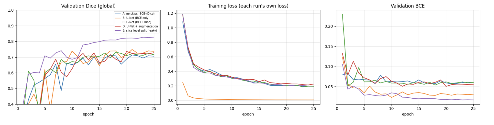
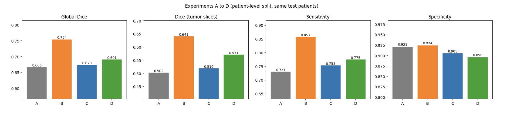
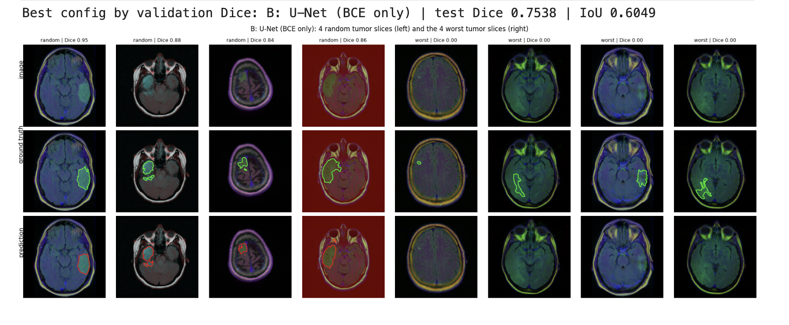
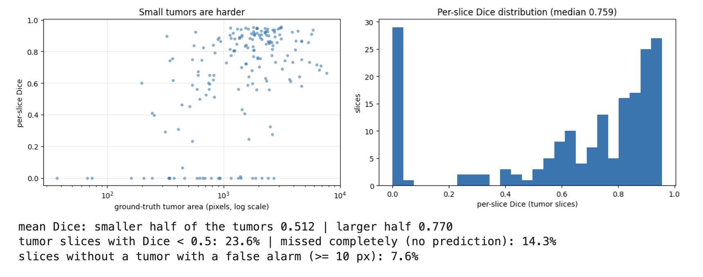
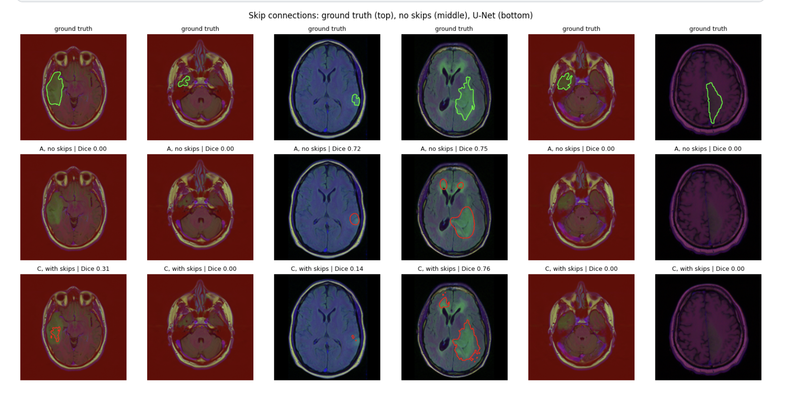
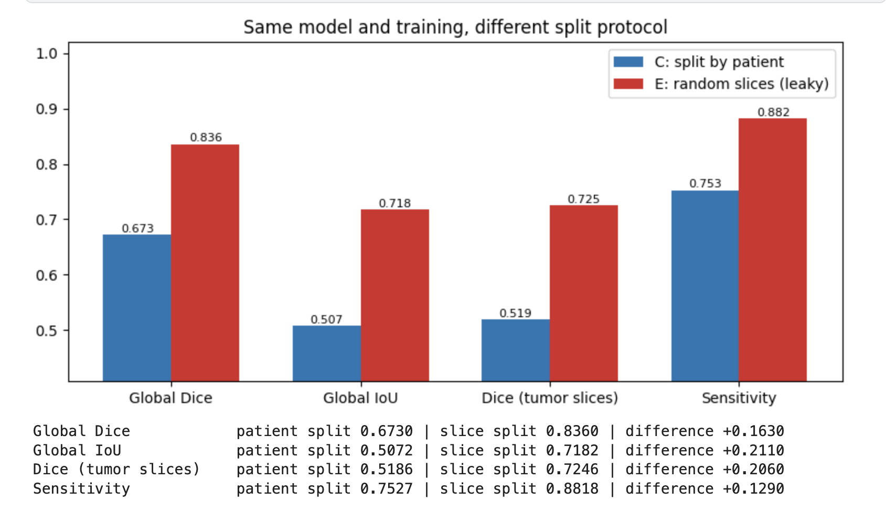

# U-Net from Scratch: Brain MRI Tumor Segmentation (PyTorch)

From-scratch PyTorch implementation of **U-Net** (Ronneberger et al., 2015) for segmenting lower-grade glioma regions in brain MRI slices. Beyond training one model, I run controlled experiments on the ideas that make segmentation work (skip connections, the loss function, augmentation) and a **data-leakage experiment** (patient-level split vs random slice-level split).

> Research and learning only. This is an educational project on a public dataset, not a medical device.

**Kaggle notebook:** _TODO: paste your Kaggle link here_
**Papers:** Ronneberger, Fischer, Brox, 2015 (U-Net) · Buda, Saha, Mazurowski, 2019 (dataset)

## Highlights
- One configurable `UNet` class; a single flag (`skip=False`) removes the skip connections for a controlled ablation.
- Five experiments (A to E) with identical architecture width, optimizer, schedule, epochs and seed.
- **Patient-level split** (all slices of a patient stay in one split), plus an experiment that quantifies how much a random slice-level split inflates the scores.
- Metrics suited to segmentation: global Dice/IoU, Dice on tumor slices, slice-level sensitivity and specificity (not pixel accuracy).
- Whole dataset kept on the GPU with GPU-side augmentation (no DataLoader workers).
- Qualitative analysis: best and worst slices, effect of tumor size, skip vs no-skip predictions.

## Background

**Semantic segmentation** assigns a class to every pixel. Here: tumor region (FLAIR abnormality) vs background in 256x256 slices.

**U-Net** is an encoder-decoder:
- **Encoder:** blocks of two 3x3 convolutions + 2x2 max-pooling; resolution halves and channels double (32 -> 64 -> 128 -> 256 -> 512).
- **Decoder:** 2x2 transposed convolutions double the resolution and halve the channels.
- **Skip connections:** encoder features are **concatenated** with the upsampled decoder features at each resolution, handing fine spatial detail to the decoder.

Signal-processing view: pooling is low-pass filtering plus decimation, so sharp boundaries are lost on the way down; a transposed convolution (zero insertion plus a learned interpolation filter) cannot recover them alone, and the skips re-inject that high-frequency detail.

Differences from the paper: "same" padding instead of unpadded convolutions + cropping, and BatchNorm after every convolution.

**Metrics**

```
Dice = 2|P ∩ G| / (|P| + |G|)      IoU = |P ∩ G| / |P ∪ G|      Dice = 2 IoU / (1 + IoU)
```

Pixel accuracy is misleading because most pixels are background. **Loss:** BCE alone favors the background; adding the soft Dice loss optimizes overlap directly (in my experiments it did not help; see the analysis).

## Architecture (base = 32 channels)

| Stage | Output (256x256 input) |
|-------|------------------------|
| Encoder 1: DoubleConv 3 -> 32 | 32x256x256 |
| Encoder 2: pool + DoubleConv 32 -> 64 | 64x128x128 |
| Encoder 3: pool + DoubleConv 64 -> 128 | 128x64x64 |
| Encoder 4: pool + DoubleConv 128 -> 256 | 256x32x32 |
| Bottleneck: pool + DoubleConv 256 -> 512 | 512x16x16 |
| Decoder 4 / 3 / 2 / 1: up, concat skip, DoubleConv | 256x32x32 / 128x64x64 / 64x128x128 / 32x256x256 |
| Head: Conv 1x1 | 1x256x256 (logits) |

DoubleConv = (Conv3x3 -> BatchNorm -> ReLU) x 2. **Parameters:** 7,763,041 with skips, 6,979,681 without (the decoder blocks receive half as many input channels).

<!-- TODO: add an architecture diagram to images/ and link it here -->

## Dataset

**LGG MRI Segmentation** (Mateusz Buda, Kaggle): about 110 patients and 3,929 slice/mask pairs of size 256x256 (3 channels: pre-contrast, FLAIR, post-contrast), with manually drawn FLAIR-abnormality masks, from The Cancer Genome Atlas. The code finds the files automatically under `/kaggle/input` (add the dataset with "+ Add Input").

- **Split:** 70% / 15% / 15% of the **patients** (patient = case folder name).
- Roughly a third of the slices contain a tumor, and tumor pixels are a small fraction of all pixels (exact numbers are printed in the notebook).

<!-- Add images/data_samples.png from the Kaggle output and uncomment:

-->

## Experiments

| ID | Skip connections | Loss | Augmentation | Split |
|----|:---------------:|------|:------------:|-------|
| A | no | BCE + Dice | no | by patient |
| B | yes | BCE | no | by patient |
| C | yes | BCE + Dice | no | by patient |
| D | yes | BCE + Dice | yes | by patient |
| E | yes | BCE + Dice | no | **random slices (leaky)** |

A vs C isolates the skips, B vs C the loss, C vs D augmentation, C vs E leakage (each model is evaluated on its own test set).

**Training setup:** Adam (lr 1e-3), cosine schedule, 25 epochs, batch size 16, mixed precision, seed 42; model selection by validation global Dice; threshold 0.5. Augmentation (D): random affine on the GPU (flip, rotation +/-15 deg, scale +/-10%, translation +/-10%), same transform for image and mask.

## Results

Test metrics at the epoch with the best validation global Dice. A to D share the same test patients; E is evaluated on its own (leaky) test split.

| Config | Skips | Loss | Aug | Split | Best epoch | Val Dice | Test Dice | Test IoU | Dice (tumor slices) | Sensitivity | Specificity | Time (s) |
|--------|-------|------|-----|-------|-----------|----------|-----------|----------|---------------------|-------------|-------------|----------|
| A: no skips | no | BCE+Dice | no | patient | 21 | 0.7135 | 0.6661 | 0.4994 | 0.5023 | 0.731 | 0.921 | 662 |
| **B: U-Net, BCE only** | yes | BCE | no | patient | 21 | **0.7484** | **0.7538** | **0.6049** | **0.6408** | **0.857** | **0.924** | 749 |
| C: U-Net, BCE+Dice | yes | BCE+Dice | no | patient | 18 | 0.7315 | 0.6730 | 0.5072 | 0.5186 | 0.753 | 0.905 | 735 |
| D: U-Net + augmentation | yes | BCE+Dice | yes | patient | 20 | 0.7361 | 0.6905 | 0.5273 | 0.5709 | 0.775 | 0.896 | 739 |
| _E: slice-level split (leaky)_ | yes | BCE+Dice | no | slice | 25 | 0.8271 | 0.8360 | 0.7182 | 0.7246 | 0.882 | 0.959 | 752 |

Parameters: 7,763,041 with skips (B to E), 6,979,681 without (A).
**Best patient-split configuration (selected on validation): B, test Dice 0.754.**








<!-- Optional: add images/tumor_size_distribution.png from the Kaggle output and uncomment

-->

## Analysis

**1. Overall performance.** The best patient-split configuration, selected on validation, is B (U-Net trained with BCE only): test Dice 0.754, IoU 0.605, mean Dice on tumor slices 0.641, sensitivity 0.857 and specificity 0.924.

**2. Data leakage inflates the scores a lot.** With the same model and training (C vs E), a random slice-level split instead of a patient-level split raises global Dice from 0.673 to 0.836 (+0.163), IoU from 0.507 to 0.718 (+0.211), Dice on tumor slices from 0.519 to 0.725 (+0.206), sensitivity from 0.753 to 0.882 and specificity from 0.905 to 0.959. Validation Dice is also higher in E (0.827 vs 0.732) because its validation split is leaky as well. A plausible explanation is that neighboring slices of the same patient are near-copies, so the model can recognize "this brain" instead of learning what tumors look like. The leakage effect (+0.16 Dice) is about twice the whole spread between configurations A to D (0.666 to 0.754), so for this setup the evaluation protocol mattered more than any architecture, loss or augmentation choice I tested. Caveat: the two test sets contain different slices, and this is a single seed.

**3. Skip connections: no clear benefit here.** A (no skips) vs C (skips): Dice 0.666 vs 0.673, IoU 0.499 vs 0.507, Dice on tumor slices 0.502 vs 0.519, sensitivity 0.731 vs 0.753, validation Dice 0.714 vs 0.732. Every number favors the skips, but the differences are small and within the noise level of this experiment (see point 9). The six-slice qualitative comparison is mixed: the U-Net is better on one slice (Dice 0.31 vs 0.00), the no-skip model is better on another (0.72 vs 0.14), they are similar on a third, and both completely miss the other three. I expected a clearer advantage in boundary quality. Possible reasons (hypotheses, not tested): the tumors in this dataset are fairly large blob-like regions where coarse localization matters more than fine boundaries; the dominant error is failing to detect the tumor in new patients, not boundary precision; and training is short with few patients. The skips cost about 0.78M more parameters (+11%) and about 11% more training time (735 s vs 662 s).

**4. Loss: BCE alone beat BCE + Dice (unexpectedly).** B vs C: test Dice 0.754 vs 0.673 (+0.081), IoU 0.605 vs 0.507, Dice on tumor slices 0.641 vs 0.519, sensitivity 0.857 vs 0.753, specificity 0.924 vs 0.905. I expected the Dice term to help with class imbalance. Two cautions: on the validation set the gap is only 0.017 (0.748 vs 0.732), so the large test gap is probably inflated by the small test set; and validation Dice fluctuates by several hundredths between epochs in all patient-split runs. Possible reasons for BCE doing well (not tested): BCE may be sufficient at this level of imbalance, and the batch-level Dice term can be noisy when most slices in a batch are empty. I cannot rank BCE and BCE + Dice with confidence from one seed, but there is no evidence here that adding Dice helps.

**5. Augmentation: small gains on test, not on validation.** C vs D: Dice 0.673 → 0.691, IoU 0.507 → 0.527, Dice on tumor slices 0.519 → 0.571, sensitivity 0.753 → 0.775, specificity 0.905 → 0.896, validation Dice 0.732 → 0.736. The direction is positive on most metrics, but the size is small compared with the noise, so I read it as suggestive only. The training loss ends higher with augmentation (about 0.22 vs 0.19), as expected for harder training data, and GPU-side augmentation added no measurable time (739 s vs 735 s).

**6. The main failure mode is missed tumors.** For the best model, the median per-slice Dice on tumor slices is 0.759 but the mean is 0.641, because the distribution is bimodal: a spike at Dice 0 (14.3% of tumor slices are missed completely, consistent with the sensitivity of 0.857) and most other slices between 0.6 and 0.95. 23.6% of tumor slices have Dice below 0.5. If the completely missed slices were excluded, the mean Dice would be about 0.75 (0.641 / 0.857, my approximation). So when the model finds a tumor it usually segments it well (the four random examples have Dice 0.84 to 0.95); the dominant error is not seeing the tumor at all. On the other side, 7.6% of slices without a tumor get a false alarm (at least 10 predicted pixels).

**7. Tumor size matters on average, but it is not the whole story.** The smaller half of the tumors has a mean Dice of 0.512 vs 0.770 for the larger half. However, several complete misses have areas of about 1,000 to 3,000 pixels, so large tumors are also missed. Of the four worst slices (all Dice 0.00), one is a tiny lesion and three are moderate lesions that are faint in the image; three of the four look like they come from the same scan (similar appearance and brain level), which is a hypothesis from visual inspection.

**8. Scans are heterogeneous.** The slices differ strongly in appearance across patients: some have a dark red background, others a green or blue tint, which probably reflects different acquisition protocols or channel intensity scales. This is a plausible contributor to the cross-patient generalization gap, but I did not test it (for example with per-image intensity normalization). In the skip-connection figure, three of the six random slices (same red background and similar anatomy) are missed or poorly segmented by both models, which again suggests that errors cluster by patient.

**9. Noisy training and model selection.** Validation Dice fluctuates by several hundredths between consecutive epochs in the patient-split runs, and the spread across A to D on validation (0.714 to 0.748) is of the same order. The best epochs are 18 to 21 out of 25. With only 16 validation and about 17 test patients, slices from the same patient are not independent, so uncertainty is larger than the number of slices suggests; a bootstrap over patients and several seeds would be needed to rank configurations reliably.

## Limitations
- Single run per configuration (one seed). The differences among A to D (about 0.09 in test Dice) are of the same order as the epoch-to-epoch noise in validation Dice, so none of the A to D rankings is conclusive.
- Only about 110 patients, with about 17 in the test set; slices of one patient are correlated, and no confidence intervals were computed.
- The comparison between C and E uses two different test sets.
- The masks are a single annotation of FLAIR abnormality from one public collection, with no external validation; slices are very heterogeneous across patients.
- 25 epochs, a small U-Net (base 32), a fixed threshold of 0.5 and no post-processing or hyperparameter search. Some runs may be undertrained.

## What I would improve
- Several seeds and bootstrap confidence intervals over patients; patient-level cross-validation
- Per-image intensity normalization or per-channel standardization to reduce scan heterogeneity
- Post-processing (remove tiny predicted components to cut false alarms, threshold tuning on validation)
- Test other Dice formulations (per-image Dice, focal Tversky), pretrained encoders, Attention U-Net, 3D context from neighboring slices
- Evaluate on an external dataset


## What I learned
- The evaluation protocol dominated everything else: a random slice split inflated Dice by 0.16 (0.67 to 0.84) with the same model, more than the whole spread between my architecture, loss and augmentation variants.
- Components I expected to help (skip connections, Dice loss) showed no clear benefit in this small-data, single-seed setting. Reporting this honestly, and noting the noise level, matters more than confirming expectations.
- The mean Dice hides the real failure mode: the per-slice distribution is bimodal, and most errors are completely missed tumors rather than imprecise boundaries.
- Errors cluster by patient and scans are heterogeneous, so slice-level statistics overstate certainty; patient-level bootstrap and multiple seeds are needed.

## Reproduce
```bash
pip install -r requirements.txt
python unet_brain_mri.py        # needs the dataset under /kaggle/input and a GPU
# or open unet_brain_mri.ipynb on Kaggle (GPU on, dataset added as input)
```

## References
- Ronneberger, Fischer, Brox (2015). U-Net: Convolutional Networks for Biomedical Image Segmentation. MICCAI.
- Buda, Saha, Mazurowski (2019). Association of genomic subtypes of lower-grade gliomas with shape features automatically extracted by a deep learning algorithm. Computers in Biology and Medicine, 109.
- Mazurowski et al. (2017). Radiogenomics of lower-grade glioma. Journal of Neuro-Oncology.
- Milletari, Navab, Ahmadi (2016). V-Net (soft Dice loss). 3DV.
