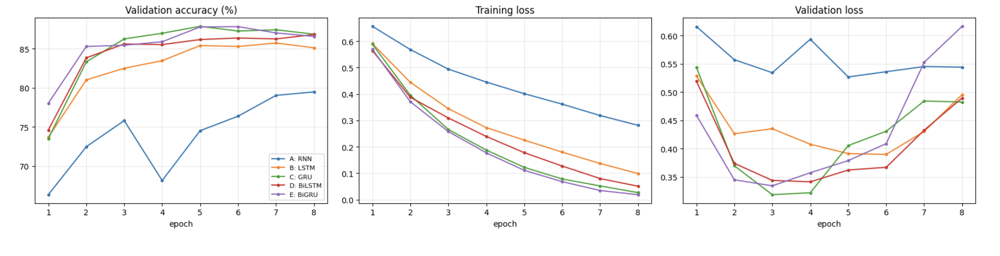
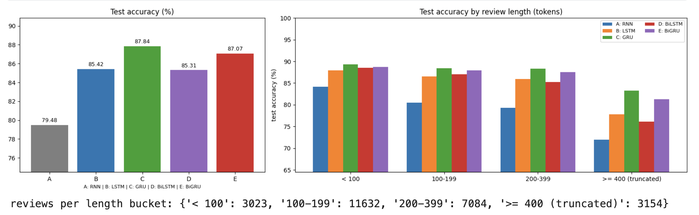
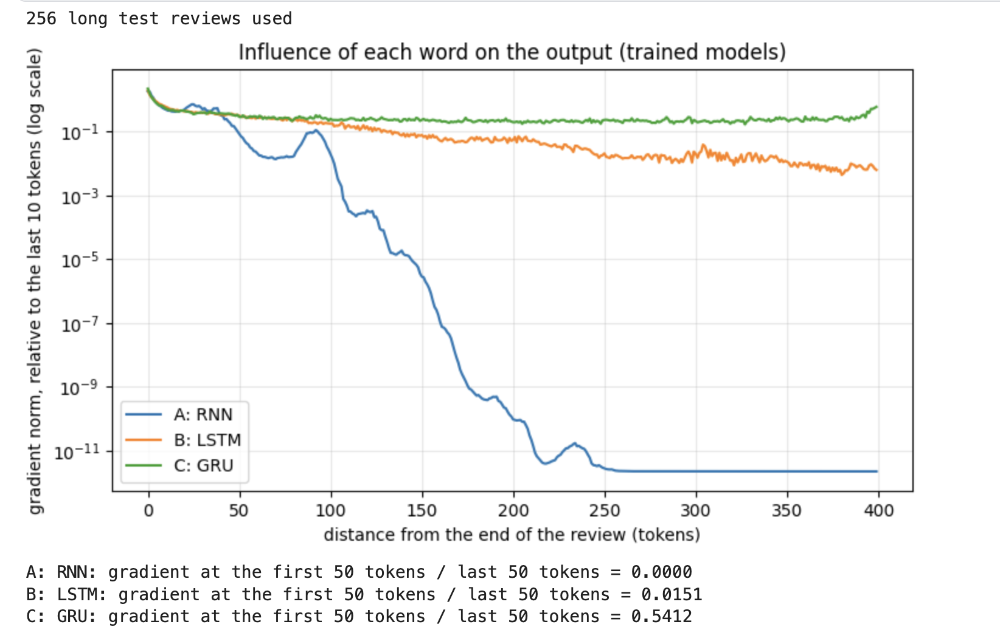

# RNN, LSTM and GRU for Sentiment Analysis on IMDB (PyTorch)

The first project of the series on **sequences and text**. I classify IMDB movie reviews as positive or negative with a vanilla RNN, an LSTM and a GRU (plus bidirectional versions), and I test directly the idea that made gated networks necessary: vanilla RNNs struggle with long sequences because gradients vanish through time.

**Kaggle notebook:** _TODO: paste your Kaggle link here_
**Papers:** Hochreiter and Schmidhuber, 1997 (LSTM) · Cho et al., 2014 (GRU) · Bengio et al., 1994 (vanishing gradients) · Maas et al., 2011 (IMDB)

## Highlights
- **Hand-written LSTM and GRU cells**, verified numerically against `nn.LSTMCell` and `nn.GRUCell` (same weights, same inputs).
- Five controlled experiments: RNN, LSTM, GRU, BiLSTM, BiGRU, with identical data, vocabulary, embedding size, optimizer and seed.
- **Gradient-through-time analysis:** norm of the output gradient with respect to the word embedding at each position of long reviews, for the RNN, LSTM and GRU.
- Accuracy broken down by review length, error analysis of the most confident mistakes, and gradient saliency of individual words.
- Careful data handling: official split with disjoint movies, exact-duplicate removal between train and evaluation sets, packed sequences so padding never reaches the final state.

## Background

**Recurrent network.** The hidden state is updated at every step, `h_t = tanh(W x_t + U h_(t-1) + b)`, and the final state summarizes the review. Signal-processing view: a recurrent layer is a nonlinear **IIR filter**; if the feedback gain is below 1, memory decays exponentially.

**Vanishing gradients.** Backpropagation through time multiplies one Jacobian per step; if their typical gain is below 1, the gradient from an early word shrinks exponentially with distance.

**LSTM.** Cell state with additive update, `c_t = f_t * c_(t-1) + i_t * g_t`, `h_t = o_t * tanh(c_t)`. Because `dc_t/dc_(t-1) = f_t`, the gradient can flow almost unchanged when the forget gate is near 1. The forget gate acts as a learned, input-dependent decay coefficient (a time-varying leaky integrator).

**GRU.** Two gates (reset, update): `h_t = (1 - z_t) * n_t + z_t * h_(t-1)`. About 25% fewer recurrent parameters than an LSTM.

**Bidirectional models** read the review in both directions and concatenate the final states (a non-causal filter, fine for offline classification).

## Model

Embedding (learned from scratch, 128 dimensions) -> recurrent layer (hidden size 128 per direction) -> dropout 0.4 -> linear layer with one logit. Sequences are packed, so the final state is the state after the last real token.

| Model | Recurrent parameters | Total parameters |
|-------|---------------------|------------------|
| RNN | 33,024 | 2,593,409 |
| LSTM | 132,096 | 2,692,481 |
| GRU | 99,072 | 2,659,457 |
| BiLSTM | 264,192 | 2,824,705 |
| BiGRU | 198,144 | 2,758,657 |

The embedding table (20,002 x 128 = 2,560,256 parameters) dominates every model.

## Dataset and preprocessing

**IMDB** (Maas et al., 2011): 25,000 training and 25,000 test reviews, balanced; the official split uses different movies in train and test. Loaded with Hugging Face `datasets` (fallback: a Kaggle CSV with a random split, which is less strict and prints a warning).

- Tokenization: lowercase, remove `<br />`, words plus `!` and `?`; vocabulary of the 20,000 most frequent training words (plus `<pad>`, `<unk>`); reviews truncated to the first 400 tokens.
- Validation: random 10% of the training reviews (shares movies with train, so it can be slightly optimistic; the official test set is the honest number).
- Leakage check: exact duplicates of training reviews are removed from validation and test (the notebook prints how many).

<!-- images/length_distribution.png from the Kaggle output can be added here -->

## Experiments and training setup

| ID | Architecture | Direction |
|----|--------------|-----------|
| A | vanilla RNN (tanh) | forward |
| B | LSTM | forward |
| C | GRU | forward |
| D | LSTM | bidirectional |
| E | GRU | bidirectional |

Binary cross-entropy, Adam (lr 1e-3), gradient clipping at norm 1.0, batch size 64, 8 epochs, seed 42; model selection by validation accuracy; test evaluated once per run. The whole dataset stays on the GPU (no DataLoader workers).

## Results

Test set: 24,893 reviews (the official 25,000 minus 107 exact duplicates of training reviews). Test accuracy is measured once, at the epoch with the best validation accuracy.

| Config | Params | Best epoch | Val acc (%) | Test acc (%) | Test F1 (%) | Time (s) |
|--------|--------|-----------|-------------|--------------|-------------|----------|
| A: RNN | 2,593,409 | 8 | 79.48 | 79.48 | 79.90 | 55 |
| B: LSTM | 2,692,481 | 7 | 85.73 | 85.42 | 85.68 | 57 |
| **C: GRU** | 2,659,457 | 5 | **87.86** | **87.84** | **87.98** | 57 |
| D: BiLSTM | 2,824,705 | 8 | 86.81 | 85.31 | 84.89 | 93 |
| E: BiGRU | 2,758,657 | 6 | 87.82 | 87.07 | 86.94 | 92 |

**Best configuration (selected on validation): GRU, 87.84% test accuracy.**





## Analysis

**1. Gated models clearly beat the vanilla RNN.** Test accuracy: RNN 79.48%, LSTM 85.42% (+5.9 pp), GRU 87.84% (+8.4 pp). The RNN also trains poorly: its training loss only falls from 0.66 to 0.28 in 8 epochs (the gated models reach 0.02 to 0.10), its validation accuracy is erratic (it drops from 76% to 68% at epoch 4), and its best epoch is the last one, so it is still improving. Part of the gap is therefore slower optimization within an 8-epoch budget, not only a lower final ceiling.

**2. Gradients vanish through time in the RNN, exactly as the theory says.** For long reviews, the gradient of the output with respect to a word's embedding, relative to the last 10 tokens:
- *RNN:* similar to the other models for the last 50 tokens, then it collapses: roughly 10 orders of magnitude lower at 150 to 200 tokens from the end, and effectively zero beyond about 250 tokens (the flat line at the bottom is my numerical floor, not a measured value). The ratio of the gradient at the first 50 tokens to the last 50 tokens is printed as 0.0000.
- *LSTM:* decays gradually, about 2 orders of magnitude over 400 tokens (ratio 0.015).
- *GRU:* almost flat, within about a factor of 2 to 5 across the whole review (ratio 0.54), with a slight rise at the very beginning of the review.

So the ranking of gradient flow (GRU > LSTM >> RNN) matches the ranking in accuracy on long reviews. Caveats: gradient magnitude shows how much the output *can be influenced* by a position, not that the model uses it well; the models are evaluated at their own best epochs (5 to 8) after different amounts of training; and this is one seed.

**3. Accuracy drops with review length for every model, most for the RNN.** Reading the grouped bar chart (approximate values): from reviews under 100 tokens to reviews of 400 tokens or more, the RNN falls from about 84% to 72%, the LSTM from 88% to 78%, the BiLSTM from 88% to 76%, the BiGRU from 89% to 81% and the GRU from 89% to 83%. The largest step for all models is the last bucket (3,154 of 24,893 test reviews, about 13%), which is exactly where reviews are **truncated to their first 400 tokens**. A plausible reason (a hypothesis) is that the verdict of a review often comes at its end and is cut off, on top of the long-range difficulty. The GRU is the most robust to length.

**4. GRU beat LSTM under identical settings.** GRU 87.84% vs LSTM 85.42% test accuracy (+2.4 pp), F1 87.98% vs 85.68%, validation 87.86% vs 85.73%, with 25% fewer recurrent parameters (99,072 vs 132,096) and the same training time (57 s). The LSTM also trains more slowly (final training loss 0.10 vs 0.03). A plausible explanation (hypothesis, not tested) is that the LSTM needs more epochs or a different setup, for example initializing the forget-gate bias to 1, to match the GRU. I would not conclude that GRU is better than LSTM in general from one seed.

**5. Bidirectional models did not help here.** BiLSTM 85.31% vs LSTM 85.42%, BiGRU 87.07% vs GRU 87.84%, while costing about 60% more training time (93 s vs 57 s). The differences are within about one point, which is the size of the gap between validation and test accuracy for some runs (BiLSTM: 86.81% vs 85.31%), so I treat bidirectionality as showing no benefit rather than harm. Possible reasons (hypotheses): the bidirectional models overfit faster (BiGRU reaches a training loss of 0.02 and its validation loss starts rising after epoch 3), and with the last hidden state as a summary the backward pass ends at the *beginning* of the review.

**6. Strong overfitting, and the models become overconfident.** For all gated models the validation loss reaches its minimum at epochs 3 to 6 and then rises (for example BiGRU from about 0.33 to 0.62), while the training loss keeps falling toward 0.02 to 0.1. Validation accuracy stays on a plateau of 86% to 88%, so the models become more confident without becoming more accurate. About 98% of the parameters are in the embedding table (2.56M of 2.6M to 2.8M), which makes memorization easy. Selecting the epoch by validation accuracy (as I did) picks a later, more overconfident epoch than selecting by validation loss would. Mean confidence on the GRU's mistakes is still 0.872 (vs 0.968 on correct predictions), so confidence is only a weak signal for flagging errors.

**7. Error analysis (GRU, the best model on validation).** The confusion matrix is [[10,791 TN, 1,626 FP], [1,401 FN, 11,075 TP]] (precision 0.872, recall 0.888); it predicts "positive" slightly more often than the true rate (51.0% vs 50.1%). All five of the most confident mistakes have confidence 1.000. From the visible first part of those reviews, they look like mixed or contradictory reviews (praise for some aspects and criticism of others), sarcasm or irony, a review that calls the film "boring" yet is labeled positive, and one 999-token review whose verdict is probably cut off by the truncation. At least some may also be ambiguous or noisy labels. I only saw the first 350 characters of each, so these are impressions, not a measured breakdown.

**8. Saliency suggests partly shortcut-like cues.** Gradient saliency (a rough, local attribution) gives some sensible top words (for example "blessed", "favorite", "bad", "avoid", "ridiculous", "recommended", "highly"), but also many arbitrary ones ("be", "me", "movies", "at"). Two patterns stand out: the number tokens "5", "10", "7", "8" (likely rating mentions) get the highest score in three examples, including both confident mistakes, and the names "chuck" and "norris" are among the top words for a negative review. This suggests the model leans on rating numbers and on entity names, which can be misleading cues (I did not see the surrounding context of those numbers, so this remains a hypothesis).

**9. Cost.** All runs take about 1 to 1.5 minutes, so running several seeds per configuration is cheap and would settle the questions above.

## Limitations
- Single run per configuration (one seed). Differences of about 1 pp or less (LSTM vs BiLSTM, GRU vs BiGRU) are not conclusive; the +2.4 pp GRU vs LSTM gap and the RNN gap are larger, but still come from one seed.
- Reviews are truncated to 400 tokens and the embedding is learned from scratch for only 8 epochs; the RNN is clearly undertrained.
- About 107 test reviews (derived from the test size of 24,893 vs the official 25,000) were removed as exact duplicates of training reviews; near-duplicates were not checked. The validation split shares movies with the training split.
- Gradient and saliency analyses are local and approximate, and the confident-mistake review is based on the first 350 characters only.
- The setup is not state of the art: no pretrained embeddings, no attention, no hyperparameter search.

## What I would improve
- Run 5 seeds per configuration and report mean ± std; select the epoch by validation loss as well as accuracy
- Initialize the LSTM forget-gate bias to 1; tune hidden size, dropout, learning rate; add embedding dropout or weight decay
- Pretrained embeddings (GloVe, fastText); attention or max/mean pooling instead of the last hidden state; keep the last 400 tokens or both ends of long reviews instead of only the first 400
- Test the rating-number shortcut (mask or randomize numbers) and calibrate the output probabilities
- Compare with a fine-tuned Transformer on the same split (Day 8)


## What I learned
- I could observe the vanishing gradient directly: for the vanilla RNN the influence of a word falls by about 10 orders of magnitude within 150 to 200 tokens, the LSTM decays gradually, and the GRU stays almost flat, matching the ranking in accuracy on long reviews.
- No architectural variant is a free lunch: the GRU beat the LSTM under identical settings and bidirectionality gave no benefit, so choices have to be tested, not assumed (and one seed is not enough to be sure).
- Validation loss rose from epoch 3 to 6 while accuracy plateaued: the models became overconfident (mean confidence 0.87 on mistakes), and the epoch chosen by accuracy is not the one chosen by loss.
- Saliency and error inspection revealed likely shortcuts (rating numbers, actor names) and ambiguous reviews, which a single accuracy number would hide.

## Reproduce
```bash
pip install -r requirements.txt
python lstm_gru_imdb.py     # needs internet (Hugging Face datasets) or the Kaggle CSV, and ideally a GPU
# or open lstm_gru_imdb.ipynb on Kaggle (GPU on, Internet on)
```

## References
- Hochreiter, Schmidhuber (1997). Long Short-Term Memory. Neural Computation.
- Cho et al. (2014). Learning Phrase Representations using RNN Encoder-Decoder. EMNLP.
- Bengio, Simard, Frasconi (1994). Learning long-term dependencies with gradient descent is difficult. IEEE TNN.
- Pascanu, Mikolov, Bengio (2013). On the difficulty of training recurrent neural networks. ICML.
- Maas et al. (2011). Learning Word Vectors for Sentiment Analysis. ACL.
