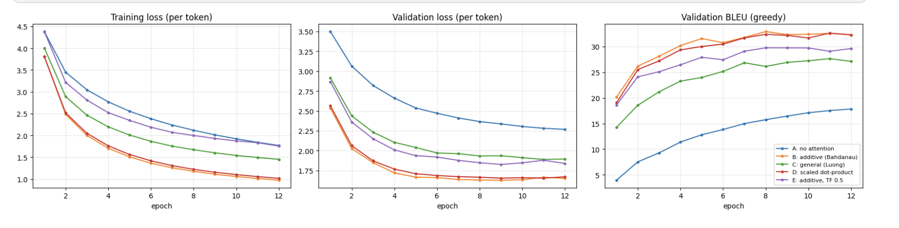
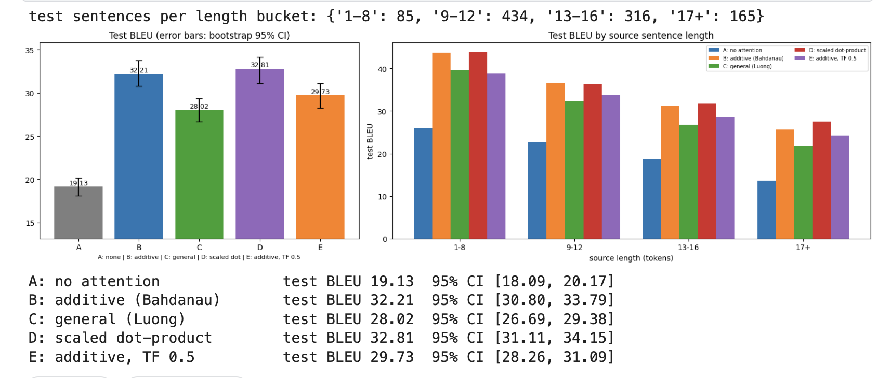
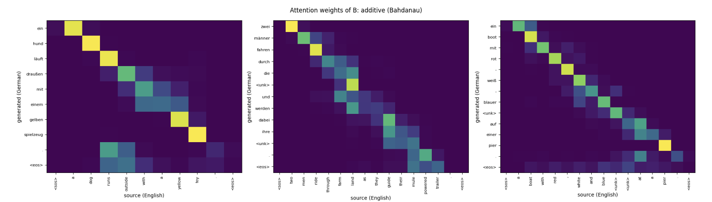

# Seq2Seq with Attention for Machine Translation (PyTorch, Multi30k English -> German)

A sequence-to-sequence translation model built from scratch, used to test the idea that led to the Transformer: **attention**. A plain encoder-decoder squeezes the whole source sentence into one fixed-size vector; attention lets the decoder look back at every source word at every step. I compare an encoder-decoder without attention against three attention score functions, and a different teacher-forcing ratio, using BLEU with bootstrap confidence intervals.

**Kaggle notebook:** _TODO: paste your Kaggle link here_
**Papers:** Sutskever et al., 2014 (seq2seq) · Cho et al., 2014 (GRU encoder-decoder) · Bahdanau et al., 2015 (additive attention) · Luong et al., 2015 (multiplicative attention)

## Highlights
- Full encoder-decoder implemented from scratch: bidirectional GRU encoder (packed sequences), step-by-step GRU decoder, masked attention.
- Four attention variants behind one flag: none, **additive (Bahdanau)**, **general (Luong)**, **scaled dot-product** (the form used in the Transformer).
- **Own BLEU implementation**, verified against SacreBLEU on random data (identical to 6 decimals), with per-sentence statistics for fast **bootstrap confidence intervals** and a **paired bootstrap** test between models.
- BLEU by source-sentence length, to test the bottleneck argument directly.
- Alignment heatmaps and attention-sharpness statistics; example translations and output statistics (length ratio, unknown words, repetitions).
- Teacher forcing 1.0 vs 0.5 (exposure bias).

## Background

**Encoder-decoder.** `P(y | x) = prod_t P(y_t | y_<t, x)`. The encoder (bidirectional GRU) produces states h_1..h_S; the decoder (GRU) generates the target word by word from `<sos>` to `<eos>`.

**The bottleneck.** Without attention the decoder only receives the final encoder state, so everything about the source must fit in one vector, and quality degrades with sentence length.

**Attention.** At each step the decoder scores its previous state s_(t-1) against every encoder state h_i, applies a softmax, and uses the weighted average as context:

```
alpha_(t,i) = softmax_i( e_(t,i) ),    c_t = sum_i alpha_(t,i) * h_i
```

Signal-processing view: attention is content-based soft addressing, a time-varying weighted average (adaptive filter) over the source positions; the weights form a soft alignment, similar to dynamic time warping.

| Score function | e_(t,i) |
|----------------|---------|
| additive (Bahdanau) | v^T tanh(W_s s + W_h h_i) |
| general (Luong) | s^T W h_i |
| scaled dot-product | s^T h_i / sqrt(d) |

All three use the previous decoder state and feed the context into the GRU; padding is masked out of the softmax.

## Architecture

| Component | Description |
|-----------|-------------|
| Source / target embeddings | 256 dimensions each, dropout 0.4 |
| Encoder | bidirectional GRU, 256 per direction (512 outputs), packed sequences |
| Bridge | `s_0 = tanh(W [h_fwd_final ; h_bwd_final])`, 512 dimensions |
| Attention | none / additive / general / scaled dot-product over the 512-dimensional encoder outputs |
| Decoder | `GRUCell` (input: previous word embedding + context), 512 hidden units |
| Output layer | linear layer on `[s_t ; c_t ; y_(t-1)]` to the target vocabulary |

Parameter counts depend on the vocabulary sizes and are printed in the notebook (see the results table).

## Dataset and preprocessing

**Multi30k** (Elliott et al., 2016), English -> German: about 29,000 training, 1,014 validation and 1,000 test sentence pairs (image captions: short sentences, narrow domain). Loaded with Hugging Face `datasets` (fallback: local Multi30k text files).

- Lowercase, regex tokenization (words and punctuation), vocabulary from the training set only (min frequency 2), special tokens `<pad> <unk> <sos> <eos>`; training pairs with more than 50 tokens are dropped.

## Experiments and training setup

| ID | Attention | Teacher forcing |
|----|-----------|-----------------|
| A | none (context only as the initial decoder state) | 1.0 |
| B | additive (Bahdanau) | 1.0 |
| C | general (Luong) | 1.0 |
| D | scaled dot-product | 1.0 |
| E | additive (Bahdanau) | 0.5 |

Cross-entropy (padding ignored), Adam (lr 1e-3), gradient clipping 1.0, batch size 128, 12 epochs, seed 42, greedy decoding. Per epoch: validation loss and **validation BLEU**; the best epoch is chosen by validation BLEU and the test set is evaluated once per run. BLEU is computed on lowercased, tokenized text, so it is **not comparable to published SacreBLEU numbers**.

## Results

Greedy decoding, BLEU on lowercased tokenized text (not comparable to SacreBLEU numbers in papers). 95% intervals come from a bootstrap over the 1,000 test sentences.

| Config | Attention | Teacher forcing | Params | Best epoch | Val BLEU | Test BLEU (95% CI) | Time (s) |
|--------|-----------|-----------------|--------|-----------|----------|--------------------|----------|
| A: no attention | none | 1.0 | 11,823,818 | 12 | 17.84 | 19.13 [18.09, 20.17] | 229 |
| **B: additive (Bahdanau)** | additive | 1.0 | 17,170,634 | 8 | **32.94** | 32.21 [30.80, 33.79] | 541 |
| C: general (Luong) | general | 1.0 | 16,907,978 | 11 | 27.65 | 28.02 [26.69, 29.38] | 509 |
| D: scaled dot-product | dot | 1.0 | 16,645,834 | 11 | 32.63 | **32.81** [31.11, 34.15] | 380 |
| E: additive, TF 0.5 | additive | 0.5 | 17,170,634 | 8 | 29.77 | 29.73 [28.26, 31.09] | 541 |

**Paired bootstrap vs no attention (BLEU difference, 95% CI):** B +13.09 [+12.02, +14.30] · C +8.88 [+7.69, +9.86] · D +13.70 [+12.27, +14.92] · E +10.61 [+9.58, +11.70]; every attention model is better in 100% of the resamples.

**Attention sharpness (test set):** additive: mean max weight 0.661, normalized entropy 0.364 · general: 0.991 / 0.008 (almost one-hot) · scaled dot-product: 0.503 / 0.565 · additive with TF 0.5: 0.589 / 0.424.

**Output statistics:** sentences with an immediately repeated word: A 5.8%, B 9.1%, C 7.7%, D 10.2%, E 37.2%; `<unk>` in the output: 3.7% to 5.0%; length ratio (hyp/ref): 0.95 to 0.99.





### Example translations (test set; reference tokenization)

| English | Reference | A: no attention | B: additive attention |
|---------|-----------|-----------------|-----------------------|
| four black men are sitting on the steps of a church . | vier schwarze männer sitzen auf den stufen einer kirche . | vier männer sitzen auf einer bank . | vier schwarze männer sitzen auf einer treppe in einer kirche . |
| a man wearing a black hat taking a photo in a busy street . | ein mann mit einer schwarzen mütze macht ein foto auf einer belebten straße . | ein mann mit einem schwarzen hut macht eine `<unk>` für eine kamera . | ein mann mit schwarzem hut macht ein foto in einer belebten straße . |
| two groups of swimmers wade out . | zwei gruppen von schwimmern waten ins wasser . | zwei rudel `<unk>` . | zwei gruppen von `<unk>` . |

## Analysis

**1. Attention makes a very large difference.** Test BLEU: no attention 19.13, additive 32.21, general 28.02, scaled dot-product 32.81, additive with teacher forcing 0.5 29.73. In the paired bootstrap against the no-attention model, the gains are +13.09 (additive; 95% CI +12.02 to +14.30), +8.88 (general; +7.69 to +9.86), +13.70 (scaled dot-product; +12.27 to +14.92) and +10.61 (E; +9.58 to +11.70), and every attention model is better in 100% of the resamples. These intervals only reflect test-set sampling noise, not variation between training runs (one seed each).

**2. Part of that gap is slower training, and part may be capacity.** The no-attention model is clearly not converged after 12 epochs: its training loss is still 1.78 (vs about 1.0 for B and D), its validation loss is still falling and its validation BLEU is still rising steeply (best epoch 12). So the +13 BLEU gap probably overstates the gap at convergence (a hypothesis). Also, the attention models have 4.8M to 5.3M more parameters (17.2M vs 11.8M) because the context vector widens the GRU input and the output layer, so I cannot separate "access to the source" from "extra capacity" with this design. A control that feeds a mean-pooled encoder state at every step (same size, no alignment) would help.

**3. Qualitatively, attention keeps the content.** In the example translations the no-attention model tends to drop or invent content: "four black men ... steps of a church" becomes "four men sit on a bench" (loses "black" and "church", invents a bench); a long sentence about an orange shirt and a blond boy turns into a different scene with a bench and two men; a sentence with an open laptop collapses into "an einem tisch ... vor einem tisch" (repeated "table"). The additive model keeps colors, objects and places ("vier schwarze männer sitzen auf einer treppe in einer kirche"). Both give the same output for a simple sentence ("a man wearing a backpack is walking down the street").

**4. The bottleneck argument is only partly supported by the length analysis.** BLEU falls with source length for every model (approximate values read from the chart: no attention 26 → 23 → 19 → 14 from the shortest to the longest bucket; additive 44 → 37 → 31 → 26; scaled dot-product 44 → 36 → 32 → 28). The *absolute* advantage of attention is actually largest for the shortest sentences (about +18 BLEU) and smaller for the longest (about +12), while the *relative* advantage is similar or slightly larger for the longest bucket (additive/no attention: about 1.7x for short sentences, 1.9x for 17+ tokens). So attention does not remove the degradation with length, and I do not see the gap growing with length in absolute terms. The shortest bucket has only 85 test sentences, and the no-attention model is weak even on short sentences, so this comparison is noisy and confounded by point 2.

**5. The score function matters: general (Luong) attention was clearly worse, and scaled dot-product matched additive.**
- Additive 32.21 [30.80, 33.79] and scaled dot-product 32.81 [31.11, 34.15] are not distinguishable (difference +0.60, overlapping intervals), but the dot-product version is **30% faster** (380 s vs 541 s) and has 525k fewer parameters.
- General attention reaches only 28.02 [26.69, 29.38], 4 to 5 BLEU below the other two with non-overlapping intervals; it also learns more slowly (training loss 1.45 vs about 1.0, validation loss 1.90 vs about 1.65 at epoch 12).
- The sharpness statistics suggest why: with general attention the mean maximum weight is 0.991 and the normalized entropy 0.008, i.e. the attention is almost one-hot (the softmax is saturated), whereas additive attention has 0.661 / 0.364 and scaled dot-product 0.503 / 0.565 (the softest). A saturated softmax passes small gradients and cannot blend neighboring words. Plausibly, the 1/sqrt(d) scaling is what keeps the dot-product scores from saturating, which is the reason it is used in the Transformer. This is consistent with my results but I did not run the unscaled-dot-product ablation that would test it.

**6. Teacher forcing 0.5 hurt.** Additive attention with teacher forcing 0.5 (E) has lower test BLEU than with full teacher forcing (29.73 vs 32.21, about -2.5; the intervals overlap slightly) and a worse validation loss (1.84 vs 1.66). Its outputs also contain far more immediately repeated words: 37.2% of sentences, against 9.1% for B. I expected a lower ratio to reduce exposure bias. A plausible explanation (not tested) is that when the model is fed its own earlier mistakes during training it learns repetitive continuations; with this short schedule, full teacher forcing worked better.

**7. Attention models repeat words more often than the no-attention model.** 5.8% of sentences have an immediately repeated word without attention, against 9.1% (additive), 7.7% (general) and 10.2% (scaled dot-product). A known weakness of plain attention is that nothing tracks which source words were already translated (coverage), so the decoder can attend to the same word twice. I did not test a coverage mechanism.

**8. Alignments look sensible.** In the three heatmaps, content words are aligned sharply along an almost diagonal path ("dog" ↔ "hund", "runs" ↔ "läuft", "yellow" ↔ "gelben", "toy" ↔ "spielzeug", "boat" ↔ "boot", "pier" ↔ "pier"). Attention is more diffuse for articles, prepositions, punctuation, `<unk>` and `<eos>`. I do not see strong word reordering in these three simple captions, because English and German word order are close here; the verb-final reordering typical of German subordinate clauses did not show up in the examples I looked at.

**9. Remaining errors.** About 3.7% to 5.0% of output words are `<unk>` for every model, because of the word-level vocabulary (rare nouns such as "swimmers" or "pullman" are unknown), which also costs BLEU. Other issues visible in the examples: omitted verbs or phrases, synonyms that BLEU penalizes (for example "treppe" instead of the reference "stufen"), and typographic differences (the model writes German quotation marks „ “ where the reference uses a plain quote). All models produce slightly short outputs (length ratio 0.95 to 0.99), so the brevity penalty lowers BLEU a little, by roughly 1% to 5% (about 1.5 BLEU for the two lowest ratios, C and E).

**10. Training dynamics.** B and D reach their lowest validation loss around epochs 8 to 9 and then it rises slightly (mild overfitting), while their validation BLEU plateaus; A and C are still improving at epoch 12. Validation and test BLEU are close for every model (within about 1.3 points).

## Limitations
- Single run per configuration (one seed). The bootstrap intervals capture only test-set sampling noise; differences of about one BLEU point (additive vs scaled dot-product, 0.60) are not conclusive.
- The no-attention baseline is undertrained (still improving at epoch 12) and has fewer parameters, so the size of the attention effect is probably overstated.
- The BLEU-by-length figures are approximate values read from a chart, the shortest bucket has only 85 sentences, and the comparison with sentence length is confounded by the baseline's weakness.
- Multi30k is small and narrow (short image captions); greedy decoding only; BLEU on lowercased tokenized text is not comparable to published SacreBLEU scores; no subword units.
- Heatmaps and example translations come from a handful of sentences; the repetition statistic only counts immediately repeated words.

## What I would improve
- Add a control with a mean-pooled context at every step (no alignment) to separate attention from extra capacity; train all models to convergence with several seeds
- Test unscaled dot-product attention and a paired bootstrap between B and D
- Coverage mechanism or a repetition penalty; beam search; subword vocabulary (BPE / SentencePiece) to remove most `<unk>` tokens; label smoothing
- Compare with a Transformer encoder-decoder (Day 8); report SacreBLEU on detokenized text


## What I learned
- Attention was by far the biggest factor (about +13 BLEU, with a paired-bootstrap interval well above zero) and visibly preserved content that the no-attention model dropped or invented, though part of that gap is the baseline's slower training and smaller size.
- The score function matters: Luong's general attention collapsed to almost one-hot weights and lost 4 to 5 BLEU, while scaled dot-product (the form used in the Transformer) matched additive attention at 30% lower cost.
- Teacher forcing 0.5 was not a free fix: BLEU dropped by about 2.5 and repeated words rose from 9% to 37%. Attention models also repeat words more often than the baseline, which motivates coverage mechanisms.
- A single BLEU number hides a lot: bootstrap intervals, output statistics and a look at the translations revealed `<unk>` tokens, repetitions, omissions and punctuation mismatches that BLEU penalizes.

## Reproduce
```bash
pip install -r requirements.txt
python seq2seq_attention_multi30k.py    # needs internet (Hugging Face datasets) or local Multi30k files, and ideally a GPU
# or open seq2seq_attention_multi30k.ipynb on Kaggle (GPU on, Internet on)
```

## References
- Sutskever, Vinyals, Le (2014). Sequence to Sequence Learning with Neural Networks. NeurIPS.
- Cho et al. (2014). Learning Phrase Representations using RNN Encoder-Decoder. EMNLP.
- Bahdanau, Cho, Bengio (2015). Neural Machine Translation by Jointly Learning to Align and Translate. ICLR.
- Luong, Pham, Manning (2015). Effective Approaches to Attention-based Neural Machine Translation. EMNLP.
- Papineni et al. (2002). BLEU: a Method for Automatic Evaluation of Machine Translation. ACL.
- Elliott et al. (2016). Multi30K: Multilingual English-German Image Descriptions.
- Post (2018). A Call for Clarity in Reporting BLEU Scores. WMT.
