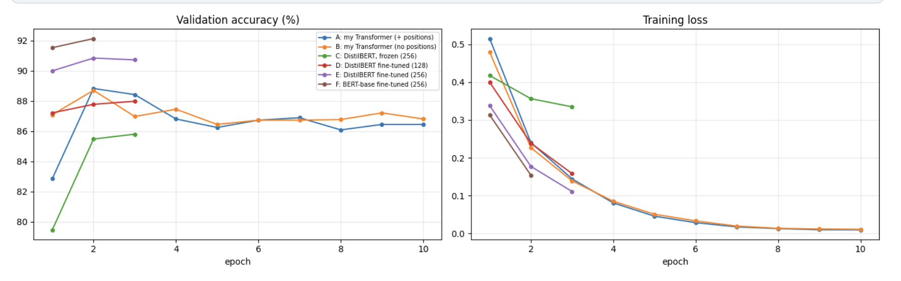
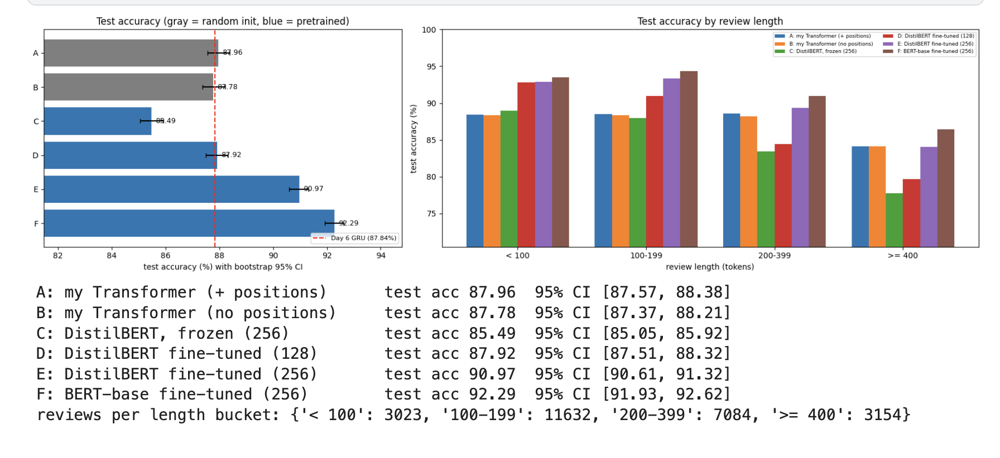
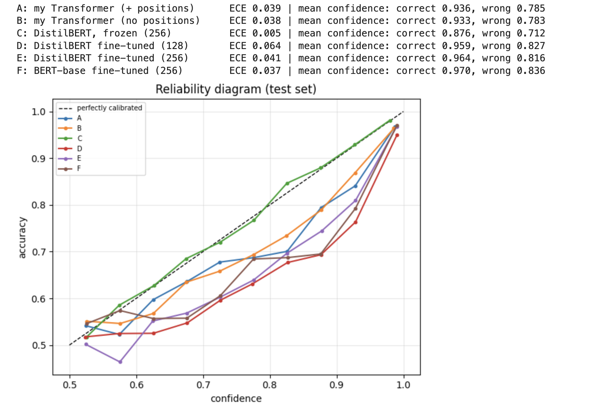
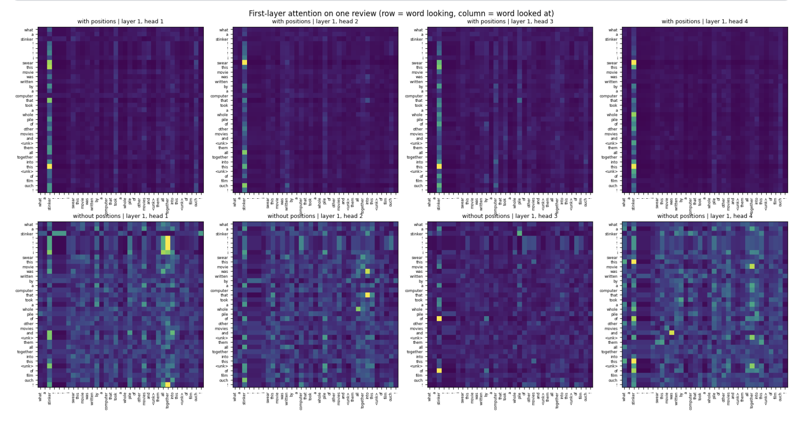

# Transformer and BERT for Text Classification on IMDB (PyTorch)

On Day 6 I classified the same IMDB reviews with RNN, LSTM and GRU (best: GRU, 87.84% test accuracy). Today I study the architecture that replaced recurrence, on **the exact same split**. I build a small **Transformer encoder from scratch** (with and without positional encodings), and I **fine-tune pretrained BERT-family models** (DistilBERT, BERT-base), then compare them with bootstrap confidence intervals, accuracy by review length, calibration, and what the attention heads look at.

**Kaggle notebook:** _TODO: paste your Kaggle link here_
**Papers:** Vaswani et al., 2017 (Transformer) · Devlin et al., 2018 (BERT) · Sanh et al., 2019 (DistilBERT) · Xiong et al., 2020 (pre-LayerNorm)

## Highlights
- Transformer encoder written from scratch: multi-head self-attention with padding masks, sinusoidal positional encodings, pre-LayerNorm blocks, residual connections, masked mean pooling.
- **Positional-encoding ablation**, with a built-in check that the model without positions is permutation-invariant (shuffling the words does not change its output).
- Same data pipeline, split and duplicate removal as Day 6, so the comparison with the GRU is direct.
- Six experiments: from scratch with / without positions, DistilBERT with a frozen backbone, fine-tuned DistilBERT at two maximum lengths, and BERT-base.
- Analyses: accuracy with bootstrap CIs and a paired bootstrap, accuracy by review length, **calibration** (ECE and reliability diagram), error analysis, first-layer attention maps of my model, and `[CLS]` attention of DistilBERT.

## Background

**Self-attention** turns each token into a query, key and value; a token's new representation is a weighted average of all values, with weights from query-key similarity:

```
Attention(Q, K, V) = softmax( Q K^T / sqrt(d_k) ) V
```

Multi-head attention runs several of these in parallel in lower-dimensional subspaces. Signal-processing view: a **content-adaptive global filter**; cost grows as O(L^2 d) vs O(L d^2) for an RNN.

**Positional encoding.** Self-attention is permutation-equivariant, so order is injected with sinusoids at geometric frequencies (a Fourier-like basis; shifting by k positions is a fixed rotation of each sin/cos pair).

**Encoder block (pre-LN):** `x = x + MHSA(LN(x))`, `x = x + FFN(LN(x))`.

**BERT** is a stack of encoder blocks pretrained with masked language modeling and next-sentence prediction; for classification a head on the `[CLS]` token is added and the whole network is fine-tuned. **DistilBERT** is a 6-layer student trained by knowledge distillation (its authors report about 40% fewer parameters and 60% faster inference with most of BERT's accuracy).

## Architecture of my Transformer encoder

| Component | Setting |
|-----------|---------|
| Embedding | 20,002 words x 128 dimensions (scaled by sqrt(128)), sinusoidal positions (or none) |
| Encoder | 2 blocks, 4 heads (d_k = 32), feed-forward width 512 (GELU), dropout 0.1, pre-LayerNorm |
| Pooling / output | masked mean over real tokens -> linear layer with 1 logit |
| Parameters | about 2.96M (2.56M in the embedding table) |

## Dataset and preprocessing

IMDB (Maas et al., 2011), official split (different movies in train and test), identical to Day 6: a random stratified 10% of the training reviews as validation (same `random_state`), and exact duplicates of training reviews removed from validation and test. The test set should contain the same 24,893 reviews as Day 6.

- From-scratch models: the Day 6 word-level tokenizer, 20,000-word vocabulary, first 400 tokens.
- Pretrained models: the `bert-base-uncased` WordPiece tokenizer (shared by DistilBERT), maximum length 128 or 256.

## Experiments and training setup

| ID | Model | Init | Trainable | Max length |
|----|-------|------|-----------|------------|
| A | my Transformer encoder + sinusoidal positions | random | all | 400 |
| B | the same without positional encoding | random | all | 400 |
| C | DistilBERT, frozen backbone + new head | pretrained | head only | 256 |
| D | DistilBERT fine-tuned | pretrained | all | 128 |
| E | DistilBERT fine-tuned | pretrained | all | 256 |
| F | BERT-base fine-tuned | pretrained | all | 256 |

- **A, B:** AdamW (lr 5e-4, weight decay 0.01), 300-step linear warmup then cosine decay, batch 64, 10 epochs, gradient clipping 1.0.
- **C to F:** AdamW, lr 2e-5 (backbone trained) or 1e-3 (head only), 10% linear warmup then linear decay, batch 32, fp16; DistilBERT 3 epochs, BERT-base 2 epochs; frozen backbone kept in eval mode.
- Best epoch by validation accuracy; test evaluated once per run; seed 42.

## Results

Test set: 24,893 reviews (the same as Day 6). Test accuracy is measured once, at the epoch with the best validation accuracy; intervals are bootstrap 95% CIs over test reviews. Reference: **Day 6 GRU, 87.84%**.

| Config | Params | Trainable | Best epoch | Val acc (%) | Test acc (%) [95% CI] | Test F1 (%) | Train time (s) | Inference, 25k reviews (s) |
|--------|--------|-----------|-----------|-------------|-----------------------|-------------|----------------|----------------------------|
| A: my Transformer (+ positions) | 2,957,185 | 2,957,185 | 2 | 88.83 | 87.96 [87.57, 88.38] | 87.85 | 299 | 11 |
| B: my Transformer (no positions) | 2,957,185 | 2,957,185 | 2 | 88.71 | 87.78 [87.37, 88.21] | 87.83 | 296 | 11 |
| C: DistilBERT, frozen (256) | 66,955,010 | 592,130 | 3 | 85.81 | 85.49 [85.05, 85.92] | 85.57 | 143 | 45 |
| D: DistilBERT fine-tuned (128) | 66,955,010 | 66,955,010 | 3 | 87.98 | 87.92 [87.51, 88.32] | 88.11 | 239 | 22 |
| E: DistilBERT fine-tuned (256) | 66,955,010 | 66,955,010 | 2 | 90.85 | 90.97 [90.61, 91.32] | 91.21 | 432 | 44 |
| **F: BERT-base fine-tuned (256)** | 109,483,778 | 109,483,778 | 2 | **92.14** | **92.29** [91.93, 92.62] | **92.38** | 546 | 85 |

**Paired bootstrap (accuracy difference, 95% CI):** A - B +0.19 pp [-0.11, +0.46] (A better in 90% of resamples) · E - A +2.99 [+2.56, +3.45] · E - C +5.49 [+5.06, +5.88] · E - D +3.05 [+2.67, +3.43] · F - E +1.31 [+1.04, +1.58].

**Calibration (ECE; mean confidence on correct / wrong predictions):** A 0.039 (0.936 / 0.785) · B 0.038 (0.933 / 0.783) · C 0.005 (0.876 / 0.712) · D 0.064 (0.959 / 0.827) · E 0.041 (0.964 / 0.816) · F 0.037 (0.970 / 0.836). For comparison, the Day 6 GRU had mean confidence 0.968 / 0.872.

**Best configuration (selected on validation): F, BERT-base, 92.29%.** Confusion matrix [[11,342, 1,075], [844, 11,632]], precision 0.915, recall 0.932.






## Analysis

**1. A small Transformer trained from scratch matches the Day 6 GRU, but not more.** Model A reaches 87.96% test accuracy (95% CI 87.57 to 88.38), against 87.84% for the Day 6 GRU on the same reviews; the GRU lies inside A's interval, so the two are indistinguishable. Without pretraining, the Transformer brings no accuracy advantage on 22,500 training reviews. It is also slower: about 30 s per epoch versus about 7 s per epoch for the Day 6 GRU (different sessions, so only a rough comparison; a plausible reason is that self-attention at 400 tokens is quadratic in length and not as heavily optimized as cuDNN's recurrent kernels).

**2. The from-scratch Transformers overfit very quickly.** Validation accuracy peaks at epoch 2 (88.83% for A) and then falls to about 86.5% while the training loss goes to about 0.01. The embedding table holds 2.56M of the 2.96M parameters, which makes memorization easy. Because the learning-rate schedule was designed for 10 epochs, the best checkpoint (epoch 2) was taken while the learning rate was still high; a shorter schedule with annealing, or stronger regularization, could probably do better (a hypothesis I did not test).

**3. Positional encoding made no detectable difference on this task.** With positions 87.96%, without 87.78%: the difference is +0.19 pp with a paired-bootstrap 95% interval of [-0.11, +0.46] (the version with positions is better in 90% of resamples), so it is consistent with zero. The model without positions is permutation-invariant (the notebook checks that shuffling the words does not change its output), so it sees the review as an unordered set of words, and it still classifies sentiment as well. This suggests that word presence carries most of the signal on IMDB, and that the order information that RNNs can exploit does not matter much here. I did not run a bag-of-words baseline (for example TF-IDF with logistic regression), which would be the natural check.

**4. First-layer attention is dominated by content, not by position.** On the one review I inspected ("what a stinker !!! i swear this movie was written by a computer ..."), all four heads of the model with positions attend heavily to the same column, the word "stinker", and the four maps look very similar (redundant heads). I do not see a diagonal or local pattern that would indicate position-based attention. Without positions the heads are more varied: heads 1, 2 and 4 show scattered peaks between specific word pairs, and head 3 looks mostly at "stinker" and "of". These are the maps of one review and one layer, so this is an illustration; attention weights are not an explanation of the model's decision.

**5. Pretraining gives a clear and large gain.** Fine-tuned DistilBERT (E) reaches 90.97% (CI 90.61 to 91.32), +2.99 pp over my Transformer (paired CI +2.56 to +3.45, better in 100% of resamples), which cuts the error rate from 12.0% to 9.0% (about 25% fewer errors). BERT-base (F) reaches 92.29% (CI 91.93 to 92.62), +4.45 pp over the Day 6 GRU: the error rate falls from 12.2% to 7.7% (about 37% fewer errors). DistilBERT is already at 90% validation accuracy after its first epoch.

**6. The gain has a price.** Compared with my Transformer, DistilBERT has 22.6x the parameters (66.96M vs 2.96M), takes 1.4x the training time (432 s vs 299 s) and 4x the inference time (44 s vs 11 s for 25k reviews); BERT-base has 37x the parameters, 1.8x the training time and 7.7x the inference time (85 s). BERT-base beats DistilBERT by +1.31 pp (paired CI +1.04 to +1.58) with 1.6x the parameters and 1.9x the inference time, although it was trained for 2 epochs instead of 3.

**7. A frozen DistilBERT is not enough.** Training only the 592k-parameter head (C) gives 85.49% (CI 85.05 to 85.92), which is **below** both the from-scratch Transformer and the Day 6 GRU, and 5.49 pp below fine-tuning (paired CI +5.06 to +5.88). Its validation accuracy was still rising at the last epoch (79.5% → 85.5% → 85.8%) and its training loss was still 0.33, so it is partly undertrained. Possible reasons for the weak result (hypotheses): the first-token representation of a model not pretrained for sentence-level features is a poor summary, and sentiment needs features that general pretraining does not provide without adaptation. This contrasts with Day 4, where frozen ImageNet features reached 96.9% against 99.85% fine-tuned.

**8. Truncation, not capacity, limits the pretrained models on long reviews.** Reading the chart (approximate values), accuracy by review length for DistilBERT with 128 tokens (D) vs 256 tokens (E): under 100 tokens 92.8% vs 92.9% (no difference, short reviews are not truncated), 100 to 199 tokens 91.0% vs 93.3%, 200 to 399 tokens 84.4% vs 89.3%, and 400 or more 79.7% vs 84.0%. The gain from the longer window (+3.05 pp overall, paired CI +2.67 to +3.43) is therefore concentrated exactly in the long reviews, which supports the Day 6 hypothesis that the verdict at the end of a long review is lost when it is cut. The frozen model shows the same decay (89.0% → 88.0% → 83.4% → 77.7%). My from-scratch Transformers, which see 400 word-level tokens, are flat at about 88.5% up to 399 tokens and only drop to about 84% for the longest reviews, so on reviews of 400 or more tokens DistilBERT with 256 WordPiece tokens (84.0%) is no better than my Transformer (84.1%), while BERT-base (86.4%) still is. On shorter reviews the pretrained models are clearly ahead (for example 92.9% vs 88.4% under 100 tokens).

**9. Calibration is reasonable everywhere, and the frozen model is the best calibrated.** ECE: A 0.039, B 0.038, C 0.005, D 0.064, E 0.041, F 0.037. The fine-tuned models are slightly overconfident (their reliability curves lie below the diagonal for confidence between 0.6 and 0.95, where accuracy is 5 to 10 points below confidence), and the 128-token DistilBERT (D) is the most overconfident. The frozen model follows the diagonal almost perfectly but is less accurate. The mean confidence on mistakes is 0.71 to 0.84 for all models here (BERT-base 0.836, against 0.872 for the Day 6 GRU, which is lower but still high), so confidence remains only a moderate signal for flagging errors.

**10. Error analysis (BERT-base).** Confusion matrix [[11,342 TN, 1,075 FP], [844 FN, 11,632 TP]] (precision 0.915, recall 0.932); it predicts "positive" more often than the true rate (51.0% vs 50.1%), the same bias as the Day 6 GRU. All five most confident mistakes (confidence 0.996) are negative reviews predicted as positive. From the first 300 characters, they look like reviews with praising wording: one praises a film as one of the greatest horror movies (possibly sarcastic), one praises an actor and the film, one calls the film "a true classic" and "the best ever" (probably a label error or irony), one starts with enthusiasm for musicals and contrasts it later with this "vaudeville show", and one calls a notorious film "a little gem" (probably irony). So the typical failure is sarcasm, a review that turns from praise to criticism after the first lines, or a questionable label; I only read the first 300 characters of each review, so these are impressions, not a measured breakdown.

**11. Validation versus test.** Validation accuracy is slightly higher than test accuracy for the from-scratch models (A: 88.83% vs 87.96%), consistent with selecting the best epoch on validation and with the validation split sharing movies with the training split; it is almost equal for the pretrained models (E: 90.85% vs 90.97%).

## Limitations
- Single run per configuration (one seed). The bootstrap intervals capture only test-set sampling noise, not training variance.
- The from-scratch models were stopped at epoch 2 of a 10-epoch schedule (high learning rate at that point), were not tuned, and are small (2 layers); the comparison with pretrained models is not at equal compute, and DistilBERT trained for 3 epochs versus 2 for BERT-base.
- Review lengths in the chart are word-level token counts (regular-expression tokenizer), used as a proxy for all models; values read from the chart are approximate.
- Reviews are truncated (400 word tokens, or 128 / 256 WordPiece tokens); exact-duplicate removal only; the validation split shares movies with the training split.
- The attention maps come from one review and one layer; the `[CLS]` attention of DistilBERT was not analyzed here.
- No bag-of-words baseline was run, so the claim that word presence carries most of the signal remains a hypothesis.

## What I would improve
- Add a TF-IDF + logistic regression baseline; several seeds; a shorter, annealed schedule and stronger regularization for the from-scratch Transformer; MLM pretraining of the small Transformer on unlabeled IMDB reviews
- Longer context (512 tokens, head+tail truncation) to test the truncation explanation directly; larger models (RoBERTa, DeBERTa)
- Temperature scaling for calibration; attributions based on gradients instead of raw attention
- Error analysis by sarcasm, negation and label noise


## What I learned
- Pretraining, not the Transformer architecture by itself, is what pays off: a small Transformer from scratch only matched the Day 6 GRU (87.96% vs 87.84%), while fine-tuned DistilBERT and BERT-base reached 90.97% and 92.29%, at 23 to 37 times the parameters and 4 to 8 times the inference time.
- A clean ablation can show that something does not matter: removing positional encoding made no detectable difference (+0.19 pp, interval including zero), which says a lot about how much word order matters for IMDB sentiment.
- The length analysis located the pretrained models' weakness exactly where truncation cuts the reviews (the 128-token model loses 5 points on reviews of 200 to 399 tokens), which supports the explanation I had only guessed on Day 6.
- A frozen backbone is not always a good shortcut: in NLP it scored below a model trained from scratch (85.49%), unlike the image case on Day 4. Calibration (ECE) and bootstrap intervals gave a fuller picture than accuracy alone.

## Reproduce
```bash
pip install -r requirements.txt
python transformer_bert_imdb.py     # needs internet (IMDB + pretrained weights) and a GPU
# or open transformer_bert_imdb.ipynb on Kaggle (GPU on, Internet on)
```

## References
- Vaswani et al. (2017). Attention Is All You Need. NeurIPS.
- Devlin et al. (2018). BERT: Pre-training of Deep Bidirectional Transformers for Language Understanding. NAACL 2019.
- Sanh et al. (2019). DistilBERT, a distilled version of BERT: smaller, faster, cheaper and lighter.
- Xiong et al. (2020). On Layer Normalization in the Transformer Architecture. ICML.
- Jain, Wallace (2019). Attention is not Explanation. NAACL.
- Guo et al. (2017). On Calibration of Modern Neural Networks. ICML.
- Maas et al. (2011). Learning Word Vectors for Sentiment Analysis. ACL.
