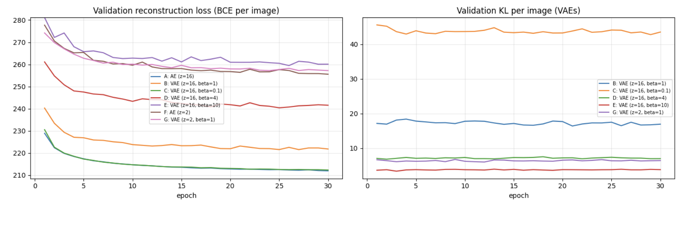
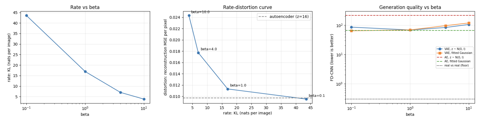
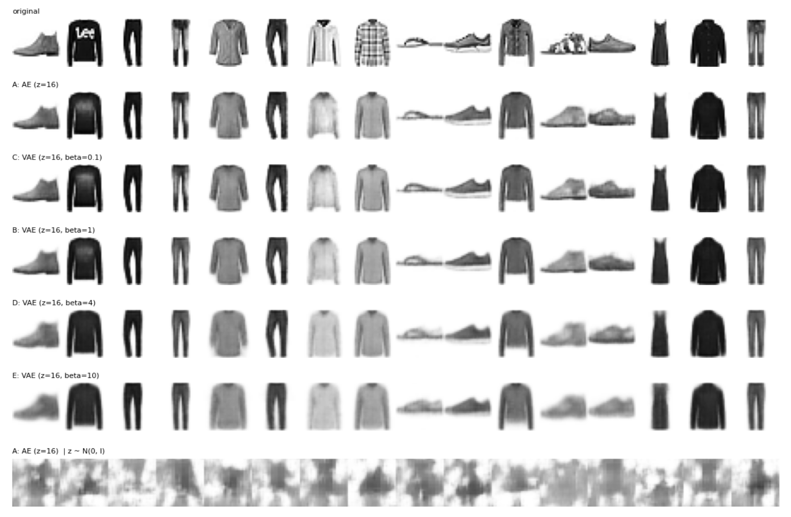
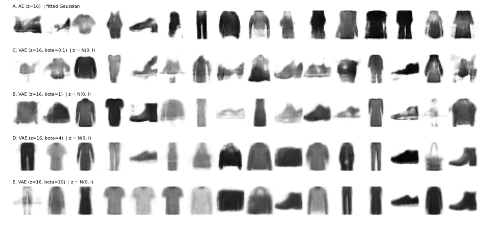
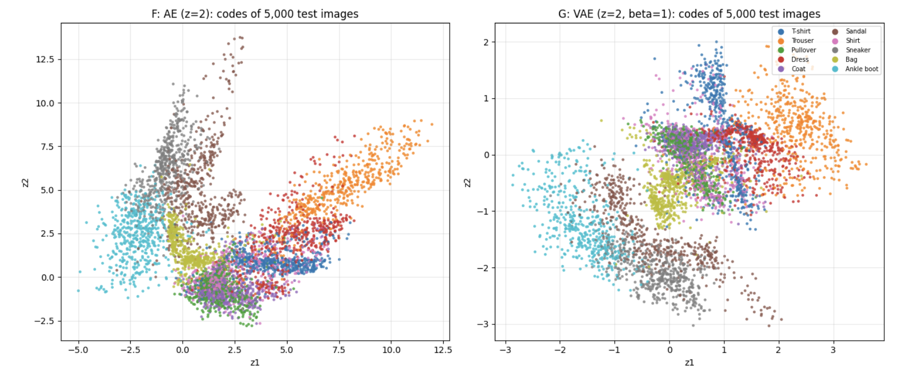
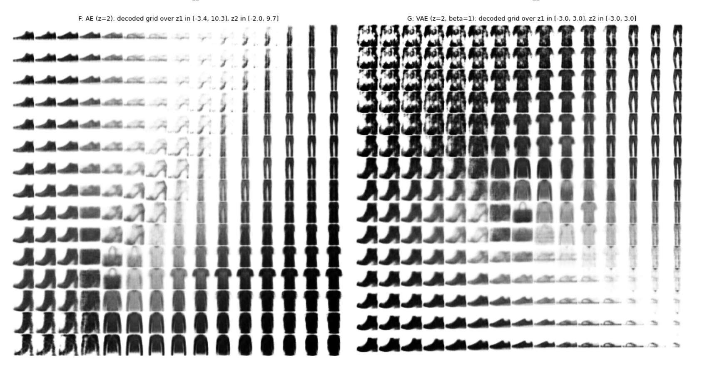
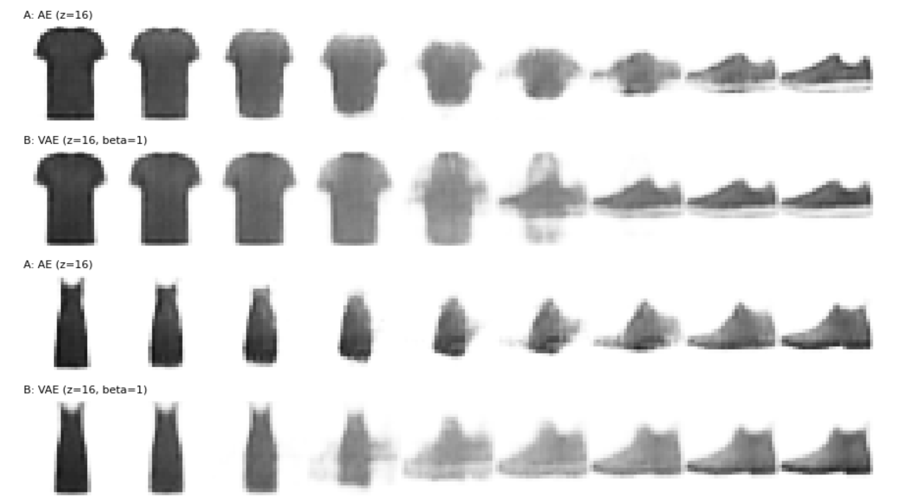
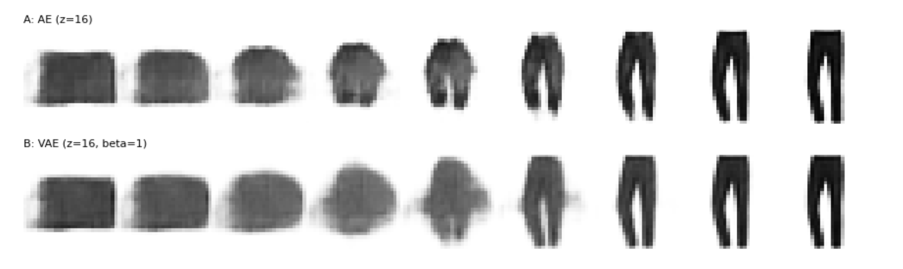
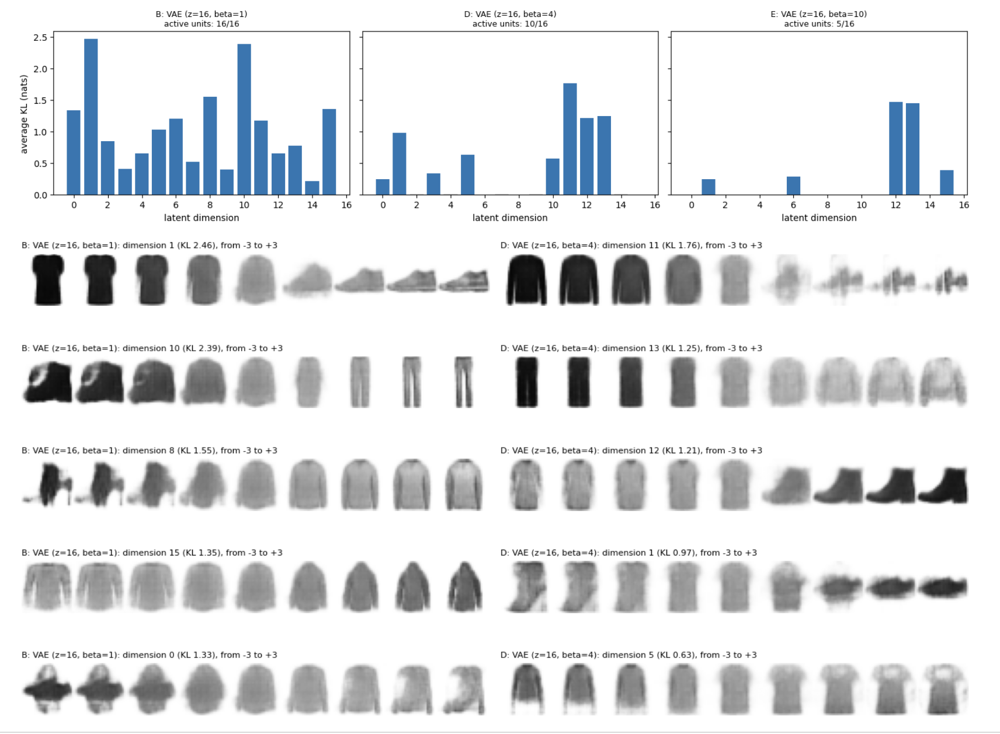

# Autoencoder and Variational Autoencoder (VAE) on Fashion-MNIST (PyTorch)

The first **generative** project of the series. I compare a plain autoencoder with a variational autoencoder and a family of beta-VAEs, and look at them from three angles: information theory (the VAE as a lossy compressor with a rate and a distortion), generation quality (a Frechet distance computed in the feature space of a Fashion-MNIST classifier, plus a fair control for the autoencoder), and the structure of the latent space itself.

**Kaggle notebook:** _TODO: paste your Kaggle link here_
**Papers:** Kingma and Welling, 2014 (VAE) · Higgins et al., 2017 (beta-VAE) · Ghosh et al., 2020 (deterministic autoencoders) · Heusel et al., 2017 (FID)

## Highlights
- Convolutional autoencoder and VAE written from scratch, with the reparameterization trick and the closed-form Gaussian KL (checked numerically against a Monte Carlo estimate).
- **Rate-distortion view of beta-VAE:** KL = rate, reconstruction error = distortion, beta = the trade-off; a beta sweep (0.1, 1, 4, 10) traces the curve.
- **Own evaluation metric, FD-CNN:** an FID-like Frechet distance in the feature space of a CNN trained on Fashion-MNIST (checked against a closed form on Gaussians), with real-vs-real floor, classifier confidence and class-histogram entropy.
- **Fair control for the autoencoder:** every model is also sampled from a Gaussian fitted to its training codes, so the VAE's advantage is not just "knowing where the codes are".
- Latent-space analysis: 2-D latent spaces and decoded manifolds, interpolations, active units and posterior collapse, per-dimension KL and latent traversals.

## Background

**Autoencoder.** An encoder compresses an image (784 pixels) into a small code z (16 or 2 numbers); a decoder reconstructs it. A linear autoencoder with squared error learns the PCA subspace. For generation, sampling a random z usually lands in "holes" between the codes of real images.

**VAE.** A probabilistic model p(z) p(x|z) with prior N(0, I); the encoder outputs a Gaussian q(z|x). Training maximizes the ELBO:

```
log p(x)  >=  E_q[ log p(x|z) ]  -  KL( q(z|x) || p(z) )
reconstruction                       regularizer
z = mu + sigma * eps,  eps ~ N(0, I)              (reparameterization trick)
KL = 0.5 * sum( mu^2 + sigma^2 - log sigma^2 - 1 )
```

**beta-VAE and rate-distortion.** Minimizing `reconstruction + beta * KL`: the KL term is the rate (nats of information about the image in the code), the reconstruction error is the distortion, and beta selects a point on the rate-distortion curve. Very large beta can cause posterior collapse (dimensions with KL near 0). A dimension is **active** if the variance of its posterior mean over the data exceeds 0.01.

**FD-CNN.** The Frechet distance between Gaussians fitted to the 128-dimensional features of real test images and of generated images: `|mu1 - mu2|^2 + Tr(S1 + S2 - 2 (S1 S2)^(1/2))`, with features from a small CNN trained on Fashion-MNIST. Lower is better; **not comparable with published FID numbers**.

## Architecture

| Part | Layers |
|------|--------|
| Encoder | Conv 1->32 (4x4, stride 2) -> ReLU -> Conv 32->64 (4x4, stride 2) -> ReLU -> flatten (3,136) -> linear -> z (autoencoder) or (mu, log sigma^2) (VAE) |
| Decoder | linear -> 3,136 -> ReLU -> reshape -> ConvTranspose 64->32 (4x4, stride 2) -> ReLU -> ConvTranspose 32->1 (4x4, stride 2) -> logits (sigmoid = pixel probability) |

Reconstruction loss: binary cross-entropy summed over pixels (a Bernoulli decoder on continuous pixels, so ELBO values are not true likelihoods). Parameter counts are printed in the notebook.

## Dataset

**Fashion-MNIST** (Xiao et al., 2017): 60,000 training and 10,000 test grayscale 28x28 images, 10 clothing classes. 55,000 images for training, 5,000 held out for monitoring curves; all metrics are reported on the test set after the last epoch (no early stopping, no model selection on the test set).

## Experiments and training setup

| ID | Model | Latent dim | beta |
|----|-------|-----------|------|
| A | autoencoder | 16 | - |
| B | VAE | 16 | 1 |
| C | beta-VAE | 16 | 0.1 |
| D | beta-VAE | 16 | 4 |
| E | beta-VAE | 16 | 10 |
| F | autoencoder | 2 | - |
| G | VAE | 2 | 1 |

Adam (lr 1e-3), batch size 128, 30 epochs, seed 42, same architecture for all. Evaluation: reconstruction BCE and MSE, accuracy of the classifier on reconstructions, KL (rate), active units, negative ELBO, and generation from (a) z ~ N(0, I) and (b) a Gaussian fitted to the training codes (10,000 samples each): FD-CNN, classifier confidence, class entropy.

## Results

All metrics on the 10,000 test images, after the last epoch. FD-CNN: lower is better (the real-vs-real floor is about 0.3, read from the figure); "Confidence" is the classifier's mean confidence on generated images, "Class entropy" the entropy of the predicted-class histogram (maximum ln 10 = 2.30). Both generation columns use 10,000 samples.

| Config | z | Params | Rec BCE (nats/img) | Rec MSE (per pixel) | KL (nats/img) | -ELBO | Active units | Recon acc (%) | FD-CNN N(0,I) | FD-CNN fitted | Confidence (N(0,I)) | Class entropy (N(0,I)) | Time (s) |
|--------|---|--------|--------------------|---------------------|---------------|-------|--------------|---------------|---------------|---------------|---------------------|------------------------|----------|
| A: AE | 16 | 170,193 | 212.92 | 0.0097 | - | - | - | 82.9 | 214.08 | **65.83** | 0.469 | 1.96 | 32 |
| **B: VAE, beta=1** | 16 | 220,385 | 222.97 | 0.0113 | 16.95 | **239.91** | 16/16 | 80.1 | **68.35** | 68.69 | 0.729 | 2.21 | 41 |
| C: VAE, beta=0.1 | 16 | 220,385 | 213.39 | 0.0095 | 43.57 | 256.96 | 16/16 | 82.6 | 85.58 | 64.15 | 0.669 | 2.18 | 41 |
| D: VAE, beta=4 | 16 | 220,385 | 242.78 | 0.0177 | 7.00 | 249.78 | 10/16 | 68.2 | 83.28 | 96.22 | 0.733 | 2.11 | 41 |
| E: VAE, beta=10 | 16 | 220,385 | 261.08 | 0.0243 | 3.82 | 264.91 | 5/16 | 59.3 | 105.68 | 118.99 | 0.765 | 1.94 | 41 |
| F: AE | 2 | 82,371 | 257.24 | 0.0292 | - | - | - | 56.3 | 212.04 | 97.03 | 0.727 | 1.12 | 31 |
| G: VAE, beta=1 | 2 | 88,645 | 258.19 | 0.0290 | 6.45 | 264.64 | 2/2 | 56.3 | 132.78 | 110.51 | 0.730 | 1.87 | 41 |

**Rate in bits (KL / ln 2):** beta=0.1: 62.9 · beta=1: 24.5 · beta=4: 10.1 · beta=10: 5.5. For the VAEs, the "fitted" column fits a Gaussian to the posterior means (not to the aggregate posterior), so it is only approximate for them.











## Analysis

**1. Regularization has a price in reconstruction.** At the same latent size (16), the autoencoder reconstructs better than the VAE with β = 1: reconstruction MSE 0.0097 vs 0.0113 (+16.5%), BCE 212.9 vs 223.0 nats (+10 nats), and the classifier recognizes the class of 82.9% of the autoencoder's reconstructions vs 80.1% of the VAE's. With β = 0.1 the VAE is practically as good as the autoencoder (MSE 0.0095, BCE 213.4, 82.6%); the tiny advantage over the autoencoder is within what one seed can produce.

**2. β traces a rate-distortion curve.** The rate (KL per image) falls from 43.6 nats for β = 0.1 (63 bits) to 17.0 nats for β = 1 (24.5 bits), 7.0 for β = 4 (10.1 bits) and 3.8 for β = 10 (5.5 bits), while the distortion (MSE per pixel) rises from 0.0095 to 0.0113, 0.0177 and 0.0243. The curve is convex with a knee near β = 1: going from 3.8 to 17 nats cuts the distortion by 54%, but going from 17 to 44 nats buys only 16% more. The classifier accuracy on reconstructions shows how much class information is kept: 82.6%, 80.1%, 68.2%, 59.3% for β = 0.1, 1, 4, 10. The training curves show that KL and reconstruction loss settle early and stay stable.

**3. Sampling an autoencoder from N(0, I) fails; a VAE works.** The autoencoder's samples from N(0, I) have an FD-CNN of 214.1 and the classifier is very unsure about them (mean confidence 0.469); visually they are texture-like blobs with no garment structure. The VAE with β = 1 reaches an FD-CNN of 68.4 (3.1 times lower), a confidence of 0.729, and a class histogram close to uniform (entropy 2.21 of a maximum of 2.30), and its samples are blurry but recognizable garments (shirts, dresses, shoes, bags, trousers). In 2-D the same pattern holds (FD-CNN 212.0 for the autoencoder vs 132.8 for the VAE; class entropy 1.12 vs 1.87).

**4. The fitted-Gaussian control: most of the VAE's advantage is knowing where the codes are.** If the autoencoder's training codes are fitted with a Gaussian and sampled from it, its FD-CNN drops from 214.1 to **65.8**, which is as good as the VAE (68.4 from the prior, 68.7 fitted). The same happens in 2-D, where the fitted autoencoder (97.0) is even better than the VAE (132.8 from the prior, 110.5 fitted). So at this scale and with this metric, the KL term does not give a better generator; what it gives is that the aggregate posterior is close to N(0, I), so that you can sample from the prior without fitting anything (consistent with Ghosh et al., 2020). All 16-dimensional models end up with an FD-CNN between 64 and 69 when sampled well, far above the real-vs-real floor (about 0.3, read from the figure), so the quality of the samples is probably limited by the blurry decoder and the Bernoulli loss rather than by the latent distribution (a hypothesis). I only looked at 16 samples per model, and the FD-CNN is a crude metric, so I would not claim the autoencoder with a fitted Gaussian is *better* than the VAE; in the samples shown, its images look a bit more broken (ghost shapes, irregular outlines).

**5. β and generation quality.** Sampling from N(0, I), the FD-CNN is 85.6 (β = 0.1), **68.4 (β = 1)**, 83.3 (β = 4), 105.7 (β = 10): a U-shape with the best value at β = 1. A small β gives a good decoder but an aggregate posterior that does not match the prior (holes), while a large β matches the prior but loses detail and diversity (class entropy falls from 2.21 to 1.94 while the classifier confidence rises, a sign of blurry prototypes). Caveat on the "fitted Gaussian" numbers for VAEs: I fitted the Gaussian to the **posterior means**, which ignore the posterior noise, so for large β (where the posterior variance is large) the fitted distribution is too narrow; this explains why it is worse than the prior at β = 4 and 10 (96.2 vs 83.3 and 119.0 vs 105.7). The fitted-Gaussian control is therefore clean for the autoencoder but only approximate for the VAEs.

**6. Posterior collapse appears as β grows.** Active units: 16 of 16 for β = 1 (the per-dimension KL is spread between about 0.2 and 2.5 nats), 10 of 16 for β = 4, and 5 of 16 for β = 10, where almost all the information is carried by two dimensions with about 1.5 nats each. The unused dimensions have a KL of 0: the encoder ignores the input there and outputs the prior. A larger β therefore trades *which* information is kept for a smaller budget.

**7. The 2-D latent spaces.** The 2-D autoencoder and the 2-D VAE reconstruct almost identically (MSE 0.0292 vs 0.0290, class accuracy 56.3% for both): with only two dimensions the model is already rate-limited (KL 6.5 nats, about 9 bits), so the regularizer costs nothing. The scatter plots look alike in topology (shoes on one side, trousers and dresses on the other, shirts, pullovers and coats overlapping in the middle), but the autoencoder's codes spread over a large, unbounded area (z1 from about -5 to 12, z2 from about -2.5 to 13.5, with elongated arms) whereas the VAE's stay in a compact region of about ±3 around the origin. In the decoded grids, the autoencoder gives plausible garments where its data lie, but also regions of faint or fragmented images in the empty parts of its latent space (the upper middle of the grid); the VAE's grid covers almost every class with clear garments and smooth transitions, but its periphery has grainy textures (upper left) and nearly blank images (lower right), which are low-density regions of the prior. So "no holes" is only approximately true.

**8. Interpolation: the VAE was not smoother (unexpected).** For three pairs (T-shirt to sneaker, dress to ankle boot, bag to trouser), the autoencoder morphs gradually from one garment to the other through a blurry hybrid. The VAE tends to stay close to the first garment for the first four steps, then changes quickly through a blurry hybrid at the middle steps, and the last three steps are nearly identical. I expected a smoother path for the VAE; with three examples I cannot say this is general, but a plausible explanation (hypothesis) is that the regularized latent space has compact clusters per garment type, so the decoder output is stable inside a cluster and changes abruptly between clusters. In neither model are the intermediate images plausible garments.

**9. Latent traversals: not cleanly disentangled.** In the β = 1 model, the most informative dimensions mostly change the **category** of the item together with its overall darkness (dimension 1 morphs a dark T-shirt into a pullover and then a shoe; dimension 10 morphs a dark bag-like shape into a shirt and then trousers; dimension 15 changes a long-sleeve top into a hooded one). In the β = 4 model, several dimensions are also category-level, with grainy artifacts at the extremes, while dimension 5 looks closer to an attribute (a dark long-sleeve top becomes a lighter short-sleeve T-shirt, i.e. sleeve length and brightness change together). Brightness changes together with the other factors in most rows. With this small architecture and 30 epochs, I do not see the clean single-attribute factors often claimed for β-VAE; the traversals are also done with all other dimensions set to 0, which may leave the data support.

**10. Cost.** The VAE adds 50,192 parameters (the extra log-variance head, 220,385 vs 170,193) and about 28% training time (41 s vs 32 s for 30 epochs). By construction the β = 1 model has the best negative ELBO (239.9 nats; 257.0, 249.8 and 264.9 for β = 0.1, 4 and 10, which optimize a different objective).

## Limitations
- Single run per configuration (one seed); differences between close values (for example autoencoder 65.8 vs VAE 68.4 with a fitted Gaussian) are not conclusive.
- The FD-CNN uses features of a classifier trained on the same data: it is a useful relative measure here, but not FID, not comparable with published numbers, and blind to details the classifier ignores. The Fréchet distance assumes Gaussian features and is biased with a finite number of samples. The real-vs-real floor value (about 0.3) was read from a figure; the classifier accuracy on real images was printed in the notebook but is not part of my analysis.
- For the VAEs, the "fitted Gaussian" uses posterior means (underdispersed), so those numbers are only approximate (see point 5).
- The decoder is a Bernoulli on continuous pixels, so the ELBO values are not true likelihoods and outputs are blurry; only 28×28 images, a small architecture, 30 epochs and no hyperparameter search.
- The sample grids, interpolations and traversals show a handful of examples; interpretations of what a dimension "means" are subjective.

## What I would improve
- Fit the Gaussian to samples z ~ q(z|x) (the aggregate posterior) for the VAEs; several seeds; more samples for the visual comparison
- KL annealing or free bits to reduce collapse; a Gaussian decoder with learned variance; a richer prior or a hierarchical VAE; test disentanglement metrics
- Real FID on a larger dataset; precision and recall for generative models; compare with a GAN (Day 10)
- Interpolate along the spherical path or in the pixel-space posterior samples; traversals starting from real images instead of the origin


## What I learned
- The rate-distortion view makes the VAE concrete: beta moves along a convex curve (KL from 44 down to 4 nats, MSE from 0.0095 up to 0.0243), with a knee near beta = 1 and posterior collapse (16, 10, 5 active units) as the rate budget shrinks.
- A control changed the conclusion: an autoencoder sampled from a fitted Gaussian generated as well as the VAE (FD-CNN 65.8 vs 68.4), so the KL term mostly buys a ready-to-sample latent space, not better samples. Without the control, the VAE would have looked 3 times better.
- Expectations were not confirmed everywhere: VAE interpolations were not smoother and the traversals were not cleanly disentangled. Reporting that honestly, with the number of examples behind it, matters more than repeating textbook claims.
- Building my own metric (FD-CNN) needs its own checks: a closed-form test, a real-vs-real floor, and awareness of its limits; and a control sample (fitted to posterior means) can itself be subtly biased.

## Reproduce
```bash
pip install -r requirements.txt
python autoencoder_vae_fashion_mnist.py     # downloads Fashion-MNIST; a GPU is recommended
# or open autoencoder_vae_fashion_mnist.ipynb on Kaggle (GPU on, Internet on)
```

## References
- Kingma, Welling (2014). Auto-Encoding Variational Bayes. ICLR.
- Higgins et al. (2017). beta-VAE: Learning Basic Visual Concepts with a Constrained Variational Framework. ICLR.
- Burda, Grosse, Salakhutdinov (2016). Importance Weighted Autoencoders. ICLR (active units).
- Ghosh et al. (2020). From Variational to Deterministic Autoencoders. ICLR.
- Heusel et al. (2017). GANs Trained by a Two Time-Scale Update Rule Converge to a Local Nash Equilibrium. NeurIPS.
- Xiao, Rasul, Vollgraf (2017). Fashion-MNIST.
- Alemi et al. (2018). Fixing a Broken ELBO. ICML.
